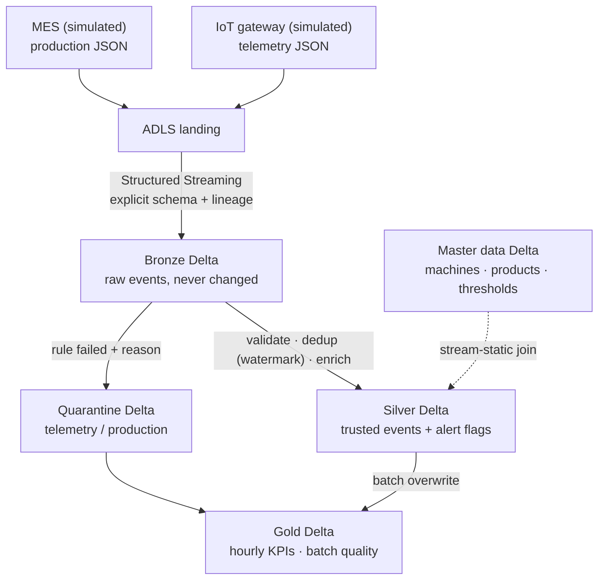

# Real-Time Manufacturing ETL on Azure Databricks


A streaming data pipeline that turns raw machine sensor readings and production events into
trusted, analysis-ready data and business KPIs, built with **PySpark Structured Streaming**,
**Delta Lake** and the **medallion (Bronze / Silver / Gold) architecture** on **Azure Databricks + ADLS Gen2**.

> **Project status:** a self-built portfolio project. The source systems (IoT gateway and MES)
> are simulated with JSON files; it does not connect to real plant equipment.

## Business problem

A manufacturer runs three machines across two plants. Operations needs near-real-time answers to:

| Question | Gold table |
|---|---|
| How many units did each machine produce this hour, and what share were defects? | `hourly_production` |
| Which machines are running above their temperature, vibration or pressure limits? | `hourly_anomalies` |
| Which production batches have the worst quality? | `batch_quality` |
| How healthy is the incoming source data, and which rules reject the most records? | `data_quality_summary` |

What the pipeline delivers:
- **Faster detection:** an overheating or over-vibrating machine is flagged within one pipeline run
  instead of being found in a next-day report.
- **Trustworthy numbers:** duplicates are removed and bad records are quarantined with a reason, so
  KPIs are not inflated by double-counted or corrupt events.
- **Nothing lost:** every raw event stays in Bronze, and a reconciliation step fails the job if
  Bronze ≠ Silver + quarantine + duplicates removed.
- **Lower cost:** jobs use `availableNow` triggers, so compute runs only while there is new data,
  not 24/7.

## Architecture



| Layer | Responsibility | Key techniques |
|---|---|---|
| **Landing** | Files as delivered by source systems | ADLS Gen2 containers |
| **Bronze** | Raw, replayable history with lineage | `readStream` + explicit schema, `ingest_timestamp`, `source_file`, one checkpoint per query |
| **Silver** | Valid, unique, enriched events | Rule-based `quarantine_reason`, `withWatermark` + `dropDuplicatesWithinWatermark`, broadcast stream-static joins, alert flags |
| **Quarantine** | Rejected rows + reason | Separate tables for telemetry and production (different schemas) |
| **Gold** | Business KPIs | Hourly windows, defect %, anomaly counts, data-quality summary |

## Data quality rules

| Telemetry | Production |
|---|---|
| missing `event_id` / `machine_id` / `plant_id` | missing `event_id` / `machine_id` / `product_id` / `batch_id` |
| unparsable timestamp | unparsable timestamp |
| null or negative temperature, vibration, pressure | null or negative units or defects |
| status not in RUNNING / IDLE / DOWN / MAINTENANCE | defects greater than units produced |

Events whose machine or product is **missing from master data** are kept (left join) with
`master_data_found = false`, and their alert flags are `NULL` (unknown), never a false "all clear".

## Repository layout

```
src/mfg_etl/        reusable pipeline code (tested locally and in CI, run by the notebooks)
  config.py         one path layout for ADLS and local runs; optional OAuth from a secret scope
  schemas.py        explicit landing schemas
  master_data.py    machine, product and threshold reference tables
  simulator.py      IoT + MES sample events with deliberate bad data
  bronze.py         streaming ingest with lineage
  silver.py         quality rules, quarantine, dedup, enrichment
  gold.py           KPI tables
  validation.py     layer counts and reconciliation
notebooks/          Databricks notebooks 00–07 (thin wrappers over src/)
resources/          Databricks job definition (7 tasks, Silver tasks run in parallel)
databricks.yml      Databricks Asset Bundle
tests/              unit tests for each rule + end-to-end streaming test with replay
scripts/run_local.py  run the whole pipeline on a laptop
.github/workflows/  CI: ruff lint + pytest on every pull request
```

## Run it locally (no Azure needed)

Requires Python 3.10+ and Java 17+. On Windows, run it inside **WSL (Ubuntu)**: plain Windows
Spark also needs Hadoop `winutils.exe`. You can skip local runs entirely: GitHub Actions runs
the full test suite on every push.

```bash
python -m venv .venv
.venv\Scripts\activate          # Windows  (macOS/Linux: source .venv/bin/activate)
pip install -r requirements-dev.txt
python scripts/run_local.py     # builds ./local_lake and prints every Gold table
pytest -v                       # unit + end-to-end tests
```

Expected result on a clean run:

| Table | Rows | Why |
|---|---|---|
| Bronze telemetry / production | 6 / 6 | every raw event kept |
| Quarantine telemetry | 2 | T005 missing machine, T006 negative temperature |
| Quarantine production | 2 | P005 missing machine, P006 defects > units |
| Silver telemetry / production | 3 / 3 | T004 and P004 duplicates kept once |
| Anomalies | 2 | T002 (press) and T004 (cutter) above limits |

`python scripts/run_local.py --replay` sends the same files again: Bronze doubles to 12, Silver stays at 3.

## Deploy to Azure Databricks

1. Create an **ADLS Gen2** storage account (hierarchical namespace on) with containers
   `landing`, `bronze`, `silver`, `gold`.
2. Give Databricks access, either:
   - **Unity Catalog** (recommended): a storage credential (managed identity) and an external location, or
   - **Service principal**: grant *Storage Blob Data Contributor*, store its secret in a secret scope
     (`databricks secrets put-secret manufacturing adls-sp-secret`) and run with `auth_mode=oauth`
     on classic compute. Secrets are never written in code or committed.
3. Set your workspace URL in `databricks.yml`, then:

```bash
databricks bundle validate -t dev --var="storage_account=<account>"
databricks bundle deploy   -t dev --var="storage_account=<account>"
databricks bundle run manufacturing_etl -t dev
```

The job runs: master data → simulate sources → Bronze → Silver telemetry ‖ Silver production → Gold → validate.
Uncomment the schedule in `resources/manufacturing_etl.job.yml` to refresh every 5 minutes.

## Design decisions

- **Why medallion?** Raw replayable history, trusted records and business metrics have different
  owners and change rates. Silver can be rebuilt from Bronze at any time.
- **Why checkpoints per query?** A checkpoint stores which files and offsets were processed. Sharing
  one between queries corrupts progress; deleting one replays data and duplicates downstream rows.
  `max_concurrent_runs: 1` stops two job runs from using the same checkpoints.
- **Why `dropDuplicatesWithinWatermark`?** Plain `dropDuplicates(["event_id"])` keeps every ID in state
  forever. Bounding it with a 15-minute event-time watermark keeps state small; the trade-off is that a
  duplicate arriving much later than the watermark is not caught.
- **Why Gold as batch overwrite?** Deterministic and easy to re-run; near-real-time when scheduled
  every few minutes. A fully streaming Gold would need MERGE/upserts and late-data handling.
- **Why `try_to_timestamp`?** With ANSI mode on, one bad timestamp would fail the whole batch. Here it
  becomes `NULL` and the row is quarantined as `bad timestamp`.
- **Why is the transformation code in `src/` and not in notebooks?** Pure DataFrame functions can be
  unit-tested in CI before anything reaches the workspace.

## Issues I hit and how I fixed them

| Problem | Root cause | Fix |
|---|---|---|
| Folders "missing" in the ADLS container | Defining an `abfss://` path doesn't create anything | Folders appear on first write; checked with `dbutils.fs.ls` |
| `CREATE DATABASE` failed: *Public DBFS root is disabled* | Default Hive warehouse location was blocked | Wrote path-based Delta to ADLS (Unity Catalog external location is the governed option) |
| `DELTA_DUPLICATE_COLUMNS_FOUND: plant_id` | Telemetry and machine master both had `plant_id` | Select only needed lookup columns before the join; assert unique column names |
| Re-running produced more rows than expected | Re-running the simulator adds new files, and deleting checkpoints replays data | Treat checkpoints as part of the table; reset both together only in a lab |

## Next steps

- Replace the file simulator with **Azure Event Hubs** (Kafka API) as the streaming source
- Register tables in **Unity Catalog** with ownership, grants and lineage
- Provision ADLS, access connector and workspace with **Terraform**
- Downtime **duration** from status transitions (counting DOWN readings is not downtime)
- Delta Live Tables / Lakeflow expectations as an alternative to hand-written rules
